# Rock Raiders Web

Rock Raiders Web (RRW) is a non-profit initiative dedicated to recreating the classic Rock Raiders PC game from 1999
using modern web technologies.

**Enjoy!**

<a href="https://github.com/Scarabol/rock-raiders-web/blob/dev/screenshots/2021-04-02%2001.png?raw=true">
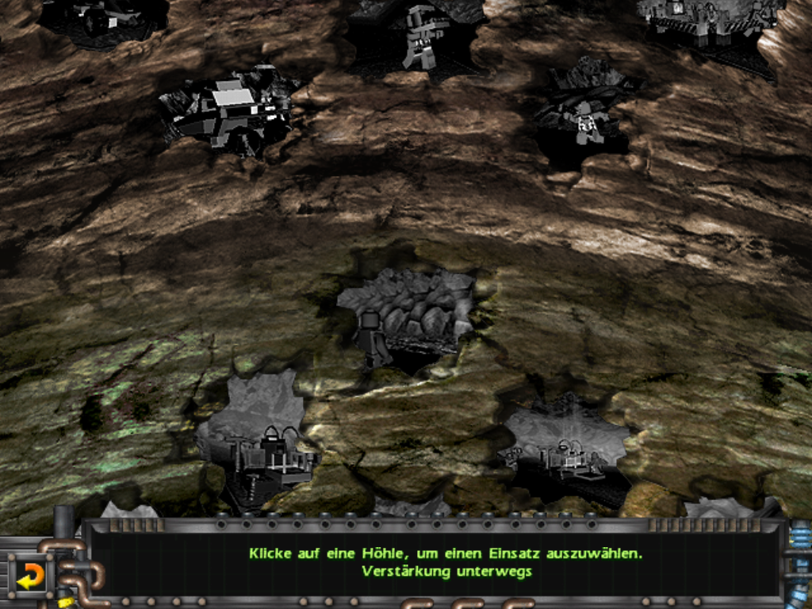
</a>
<a href="https://github.com/Scarabol/rock-raiders-web/blob/dev/screenshots/2021-04-02%2002.png?raw=true">
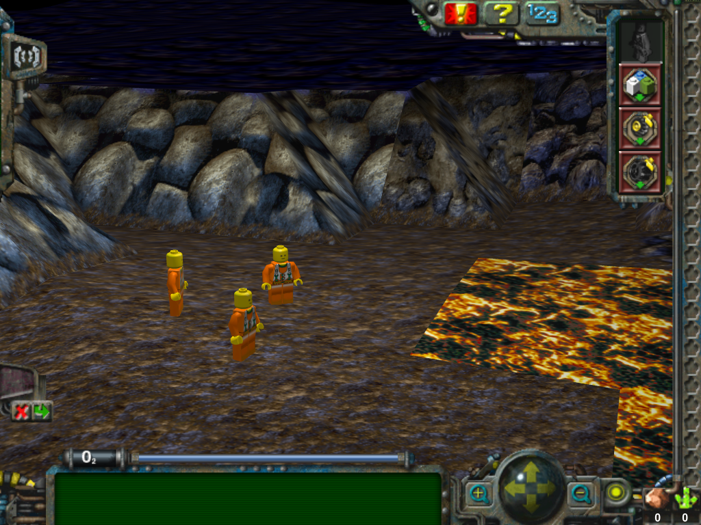
</a>

<a href="https://github.com/Scarabol/rock-raiders-web/blob/dev/screenshots/2021-04-02%2003.png?raw=true">
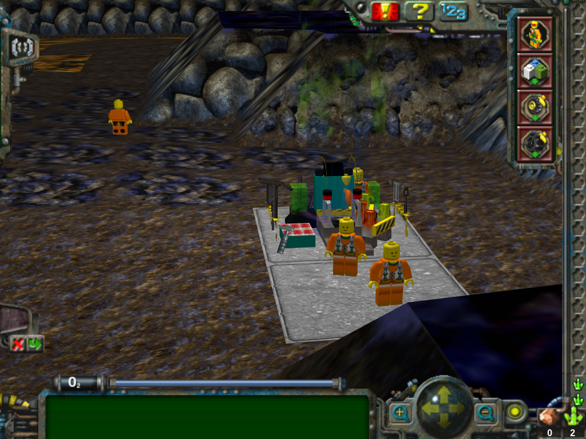
</a>
<a href="https://github.com/Scarabol/rock-raiders-web/blob/dev/screenshots/2021-04-02%2004.png?raw=true">
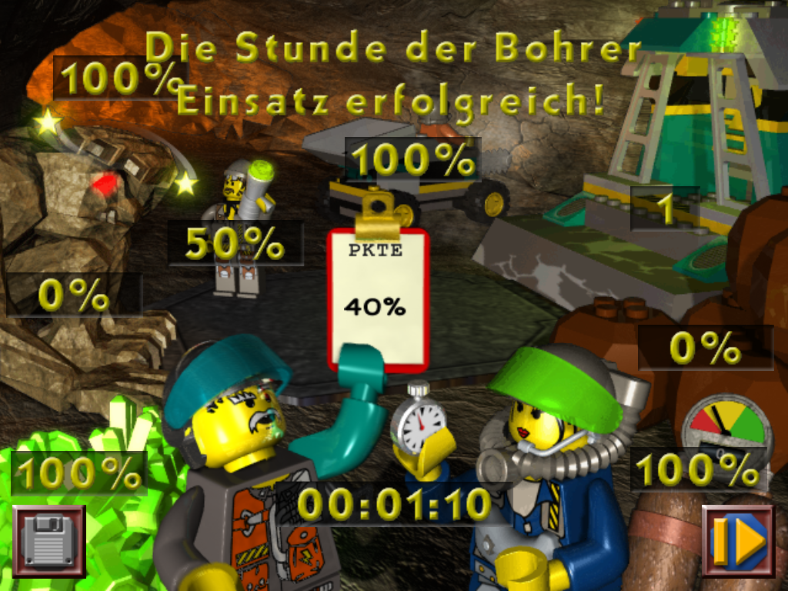
</a>

<a href="https://github.com/Scarabol/rock-raiders-web/blob/dev/screenshots/2021-07-05%2001.png?raw=true">
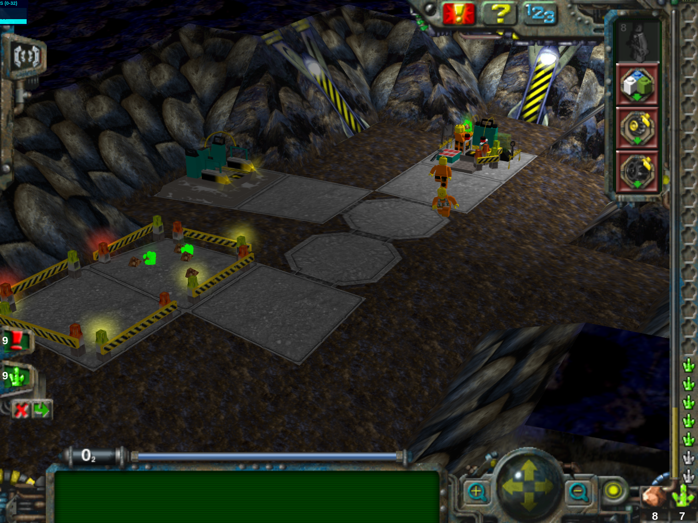
</a>
<a href="https://github.com/Scarabol/rock-raiders-web/blob/dev/screenshots/2021-07-05%2002.png?raw=true">
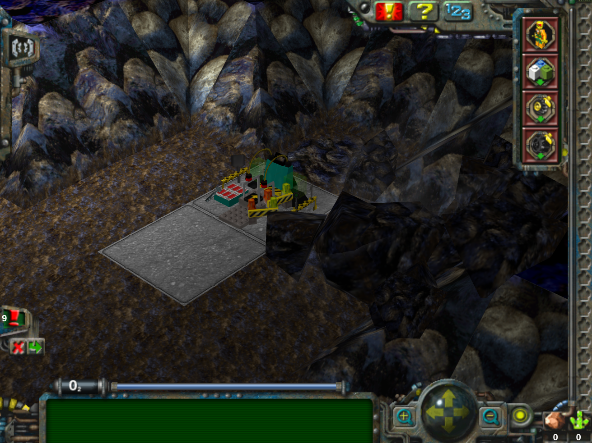
</a>

<a href="https://github.com/Scarabol/rock-raiders-web/blob/dev/screenshots/2022-03-20%2001.png?raw=true">
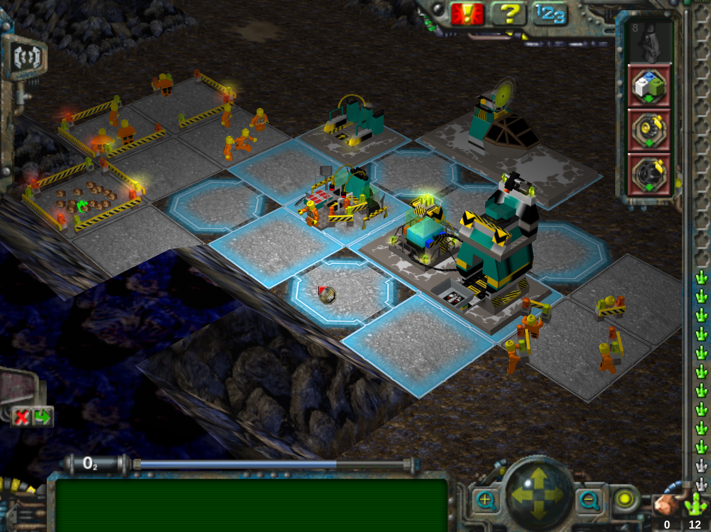
</a>
<a href="https://github.com/Scarabol/rock-raiders-web/blob/dev/screenshots/2022-03-20%2002.png?raw=true">
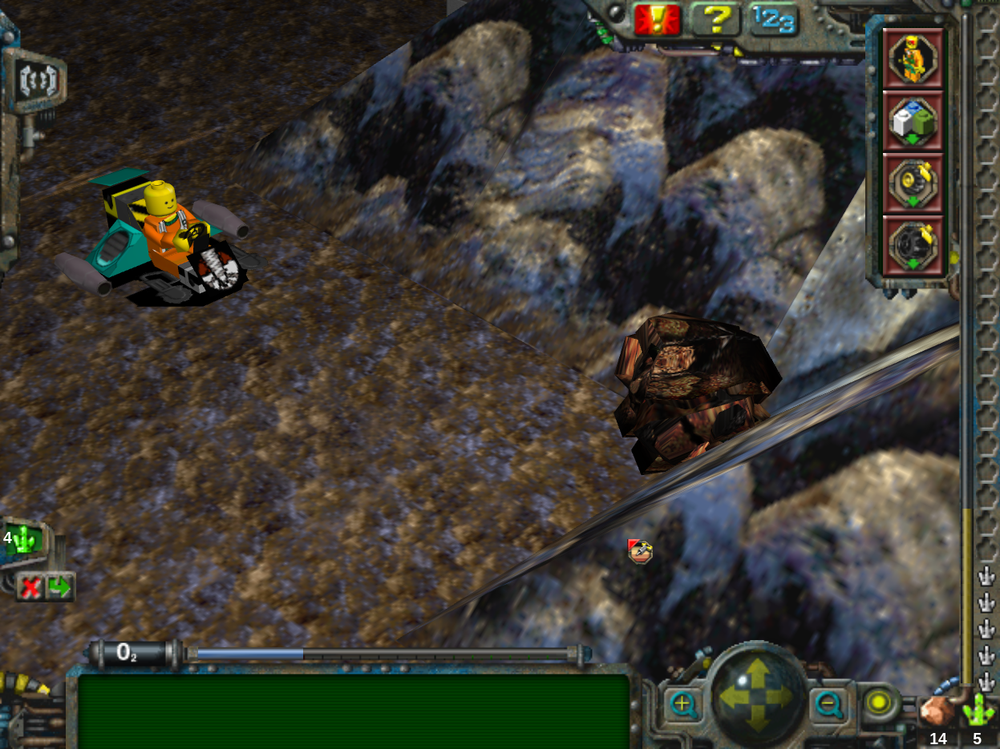
</a>

<a href="https://github.com/Scarabol/rock-raiders-web/blob/dev/screenshots/2022-03-20%2003.png?raw=true">
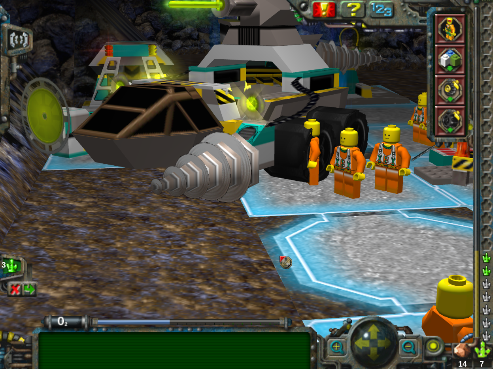
</a>
<a href="https://github.com/Scarabol/rock-raiders-web/blob/dev/screenshots/2022-03-20%2004.png?raw=true">
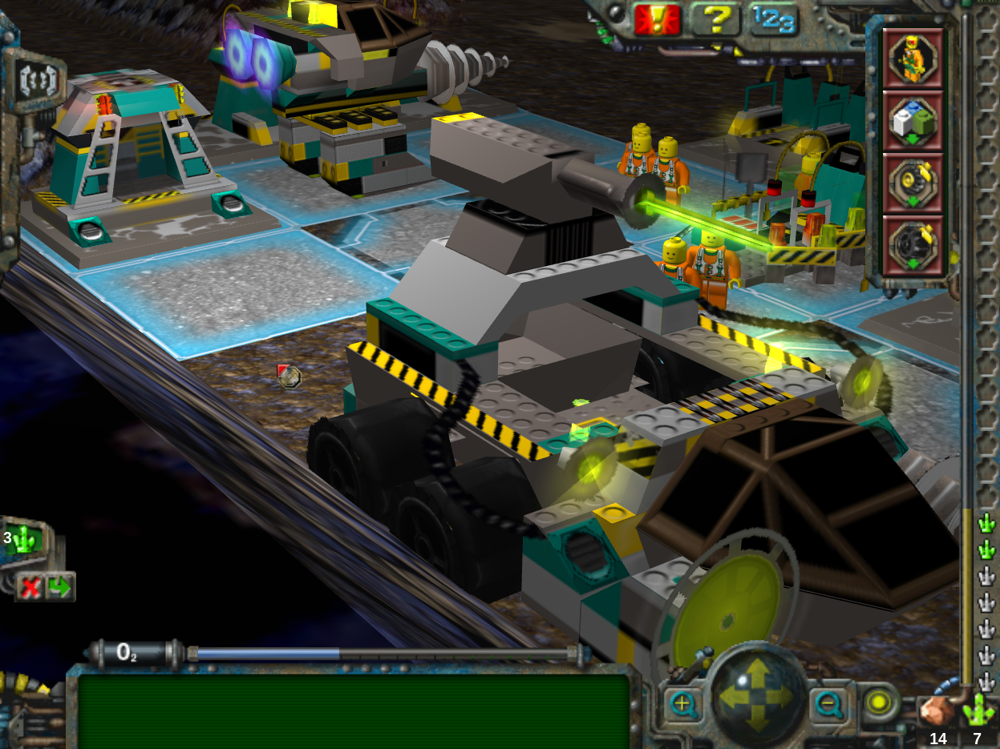
</a>

<a href="https://github.com/Scarabol/rock-raiders-web/blob/dev/screenshots/2023-10-26%2001.png?raw=true">
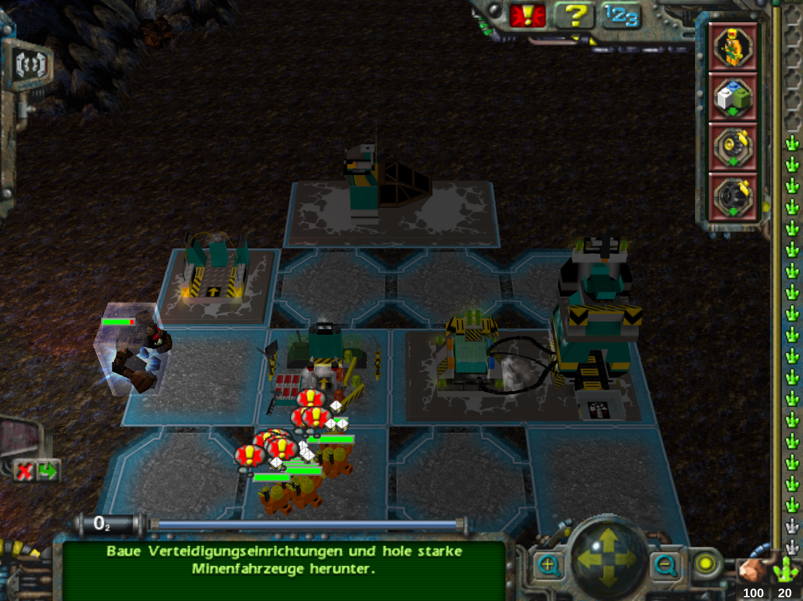
</a>
<a href="https://github.com/Scarabol/rock-raiders-web/blob/dev/screenshots/2023-10-31%2001.png?raw=true">
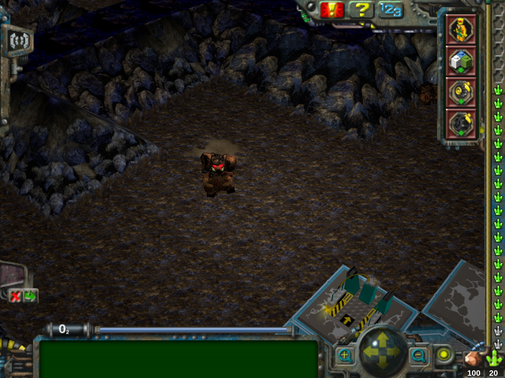
</a>

<a href="https://github.com/Scarabol/rock-raiders-web/blob/dev/screenshots/2024-12-23%2001.png?raw=true">
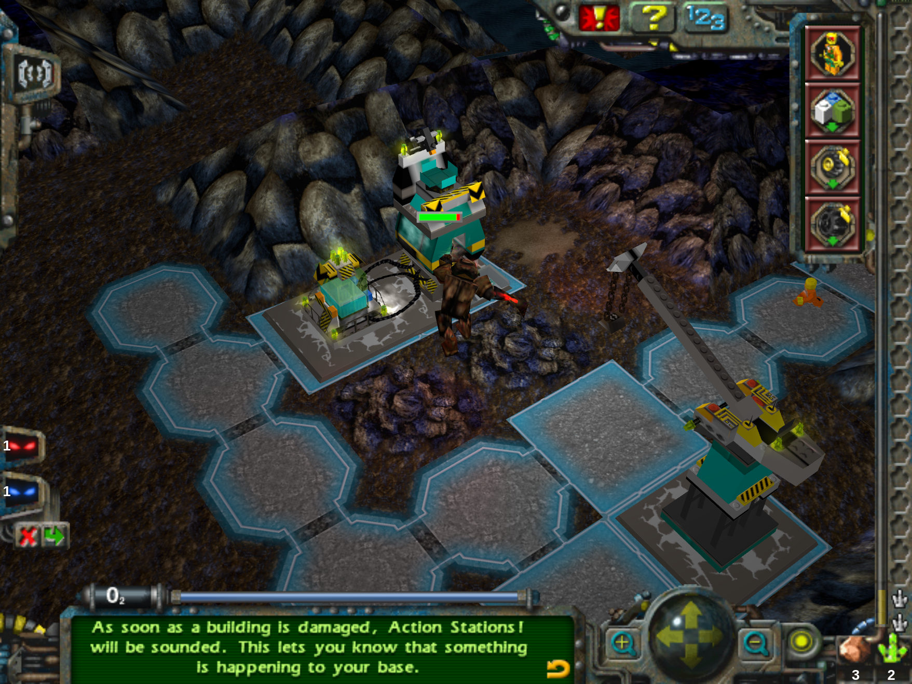
</a>
<a href="https://github.com/Scarabol/rock-raiders-web/blob/dev/screenshots/2025-02-03%2001.png?raw=true">
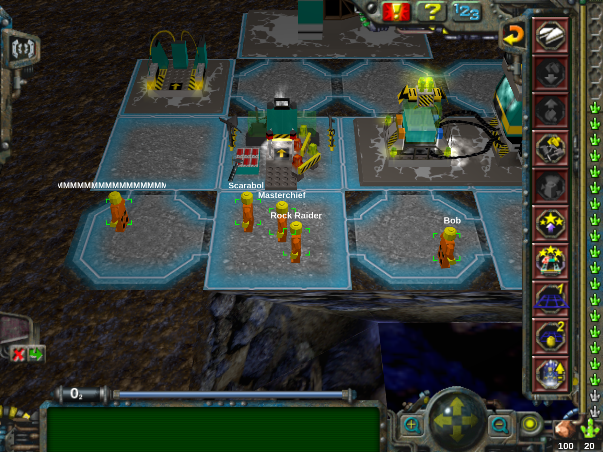
</a>

## Recommended Browser

The game is developed with Chromium-based browsers, so Chromium is recommended for the best-tested experience. It should
generally work in other modern browsers as well.

### Known Differences

In Chromium-based browsers, Escape is captured while the game is fullscreen so a normal press opens the in-game pause
menu. Holding Escape until the browser exits fullscreen only exits fullscreen; it does not also open the pause menu.
Browsers without the Keyboard Lock API keep their native fullscreen Escape behavior.

## Development Roadmap

### v0.9.x - Polishing

- Fix balancing for lava erosion, see [#35](https://github.com/Scarabol/rock-raiders-web/issues/35)
- Fix clear rubble job priority not effective, see [#43](https://github.com/Scarabol/rock-raiders-web/issues/43)

### v1.0.0 - Final Release

- Fix all remaining bugs

## Known Issues

### Cosmetics

- Adjust entities rotation speed and play turnLeft, turnRight animations
- Advisor not shown in tutorials near icon panel

### Authentic

- Surface object pointer in tutorials removes surface highlight color as in original

## Technical Debt

- Move three.js rendering to separate worker (blocked
  until [worker support for audio](https://github.com/WebAudio/web-audio-api/issues/2423) is solved,
  so [AudioContext](https://github.com/mrdoob/three.js/blob/master/src/audio/AudioContext.js) does not need _window_
  anymore)

## Development

To start development environment, please take the following steps:

```bash
git clone https://github.com/scarabol/rock-raiders-web.git
cd rock-raiders-web
npm install
npm run dev
```

## Credits

### Related Projects

* [Rock Raiders Remake](https://github.com/rystills/rock-raiders-remake) - another web based 2D clone
* [toolstore.io](https://github.com/marcbizal/toolstore-io) - web based WAD file handling
* [RRU](https://www.rockraidersunited.com/) - Game and mods community
* [Reddit Community](https://www.reddit.com/r/Rockraiders/) - Subreddit

### Technical Stuff

* [three.js](https://github.com/mrdoob/three.js) - Web based 3D Engine
* [IDB-Keyval](https://github.com/jakearchibald/idb-keyval) - Indexed cache handling helper
* [zip.js](https://github.com/gildas-lormeau/zip.js) - JavaScript library to zip and unzip files
* [pako](https://github.com/nodeca/pako) - zlib JavaScript port to unpack files from CAB

### Media

* [YouTube walkthrough](https://www.youtube.com/watch?v=2jQ93-cdJeY) - Nice walkthrough with many details

### Support This Project

This project is meant to be work of passion without any commercial intentions.

Still want to invite me for coffee? This way
please <a href="https://ko-fi.com/scarabol" target="_blank">https://ko-fi.com/scarabol</a>
